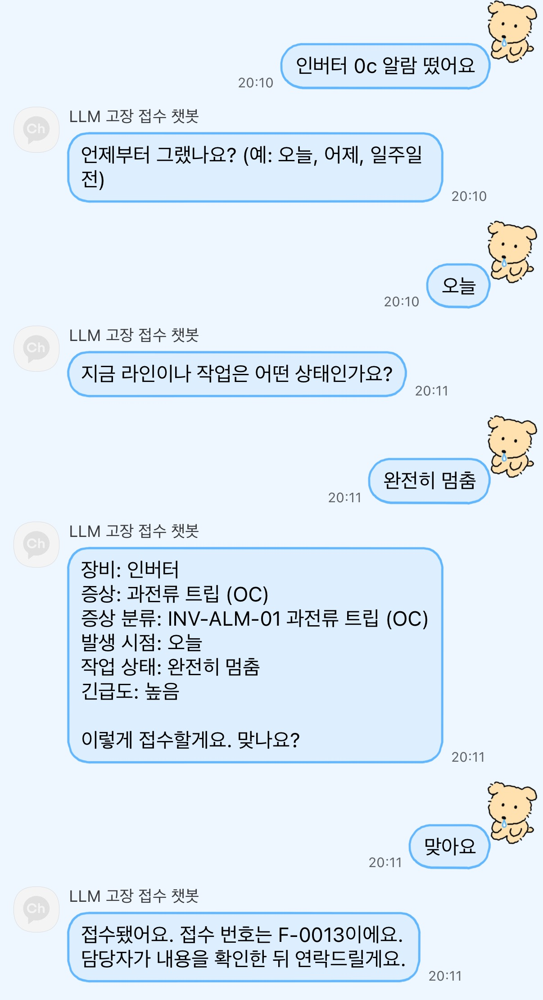
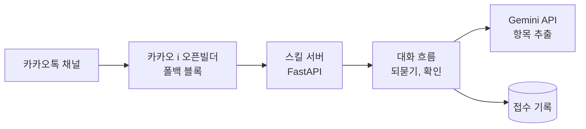

# llm-fault-intake

카카오톡 챗봇으로 산업용 전자 장비(HMI, 인버터, 서보드라이브, PLC, 산업용 PC, 파워서플라이)의 고장을 접수하는 LLM 프로젝트입니다. 현재 진행 중입니다.

## 하는 일

접수자가 고장 증상을 평소 말투로 보내면 LLM이 장비, 증상, 증상 분류 코드, 발생 시점, 작업 상태를 뽑고, 빠진 항목은 되묻습니다. LLM이 정리한 내용은 초안이고 최종 확정은 담당자가 합니다.

## 시연

카카오톡 채널에서 실제로 접수한 화면입니다. 버튼을 누르거나 평소 말투로 답하면 빠진 항목을 묻고, 접수 내용을 확인받은 뒤 접수 번호를 줍니다.



서버는 GitHub Codespaces에서 실행합니다. Codespace가 꺼져 있으면 채널이 답하지 않습니다.

## 구성



| 파일 | 하는 일 |
|---|---|
| `src/kakao_server.py` | 오픈빌더 요청을 받아 카카오 응답 형식(버튼 포함)으로 돌려줌. LLM 호출은 카카오 5초 제한에 맞춰 4초에서 끊음 |
| `src/dialog.py` | 빠진 항목 되묻기, 접수 확인, 장비가 바뀌는 경우 확인, 호출 실패 시 대화 보존 |
| `src/extract.py` | LLM으로 장비, 증상, 증상 분류 코드, 발생 시점, 작업 상태 추출 |

## 현재 결과

| 데이터 | 문장 수 | 통과 |
|---|---|---|
| 조정용 (`data/dev.csv`) | 20 | 19 |
| 시험용 (`data/holdout.csv`) | 12 | 11 |

모델은 `gemini-3.5-flash-lite`입니다. 실패 사례와 프롬프트를 고친 과정은 [docs/evaluation.md](docs/evaluation.md)에 있습니다. 가상 데이터이고 문장 수가 적어서, 이 숫자는 실제 접수 성능이 아닙니다.

## 문서

- [요구사항 정의서](docs/requirements.md)
- [대화 흐름](docs/conversation-flow.md)
- [화면 설계](docs/screen-design.md)
- [데이터와 증상 분류표](data/README.md)

## 데이터

실제 업체 데이터는 쓰지 않았습니다. 장비 목록, 증상 분류표, 문장은 모두 직접 만들었습니다.

## 실행

Gemini API 키(무료 등급)를 `GEMINI_API_KEY` 환경변수로 설정한 뒤 실행합니다.

```
pip install -r requirements.txt
python scripts/evaluate.py                    # 조정용
python scripts/evaluate.py data/holdout.csv   # 시험용
```

## 진행 상황

- [x] 요구사항 정의, 대화 흐름, 화면 설계
- [x] 가상 증상 데이터와 증상 분류표
- [x] 항목 추출과 채점
- [x] 되묻기 대화 흐름 구현
- [x] 카카오톡 챗봇 연결
- [ ] 항상 켜져 있는 서버로 옮기기
