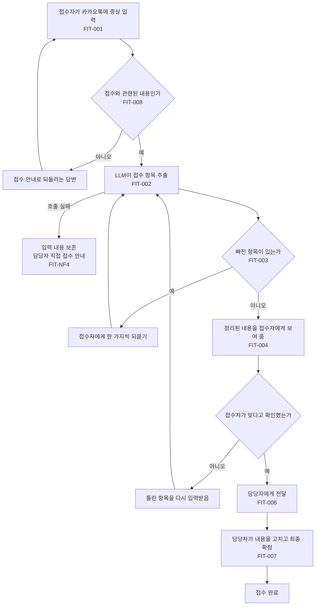
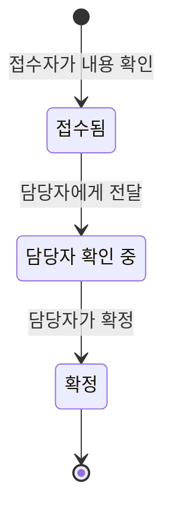

# 대화 흐름도

접수자가 카카오톡 챗봇에 증상을 말한 뒤 담당자가 확정하기까지의 흐름이다.
노드 아래의 ID는 [요구사항 정의서](requirements.md)의 요구사항과 같다.

## 접수 흐름

사진 첨부(FIT-005)는 접수 중에 보낼 수 있고, 해당 접수에 연결해 저장한다.

## 접수 상태

접수자가 조회하는 상태(FIT-009)는 세 가지다.

